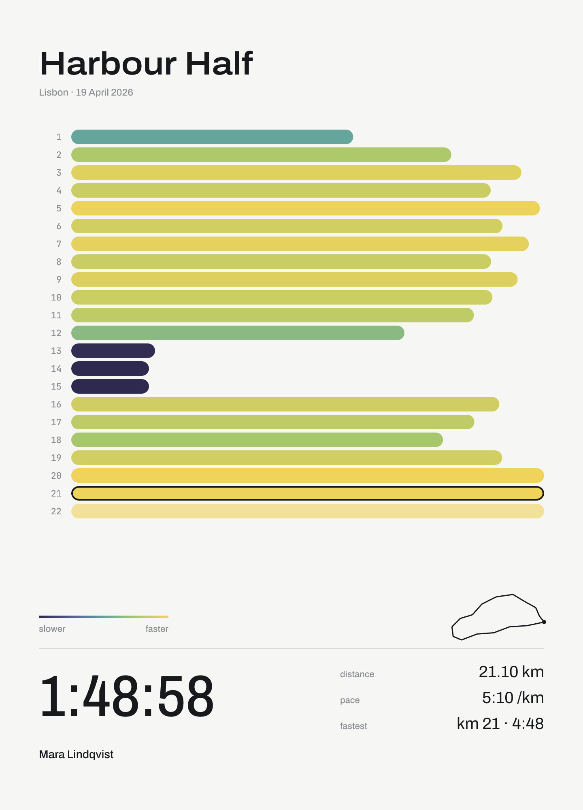
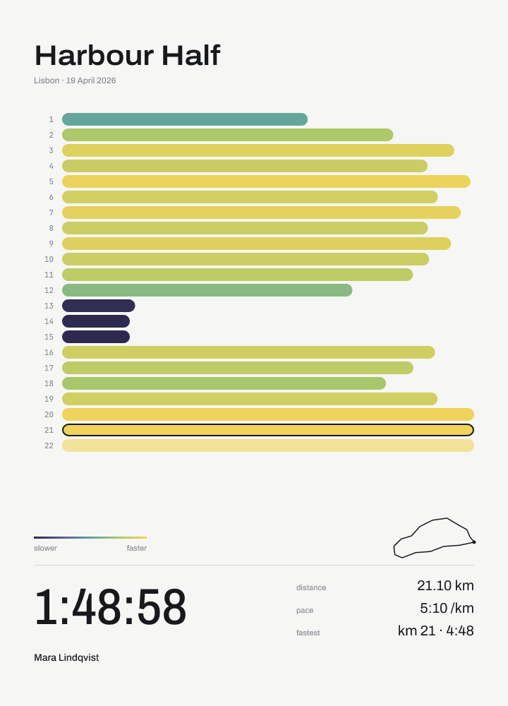
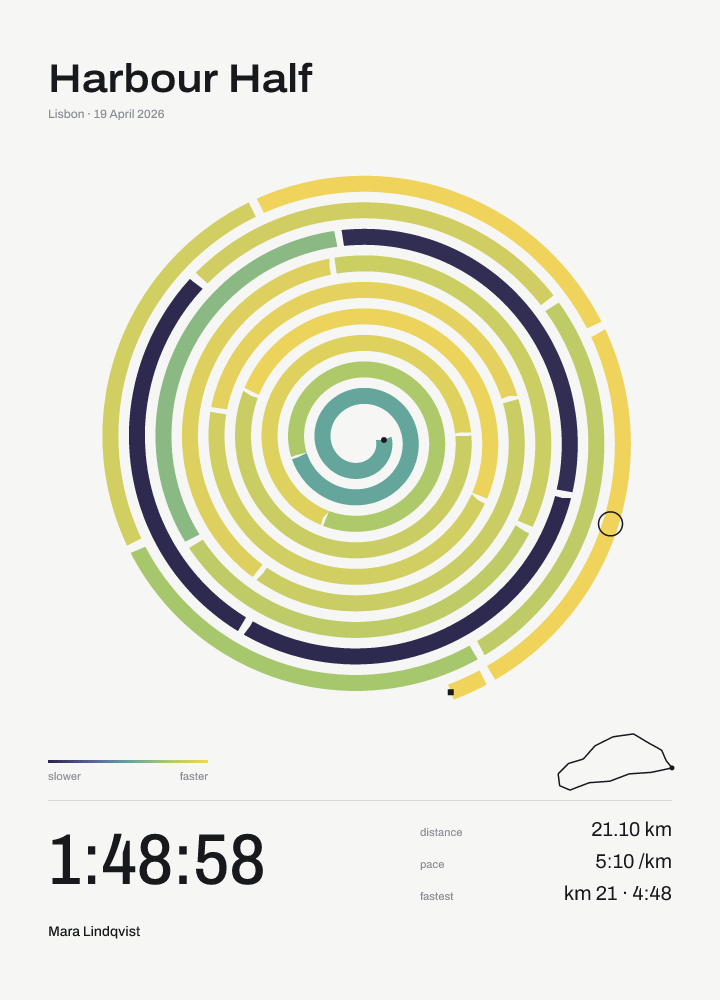
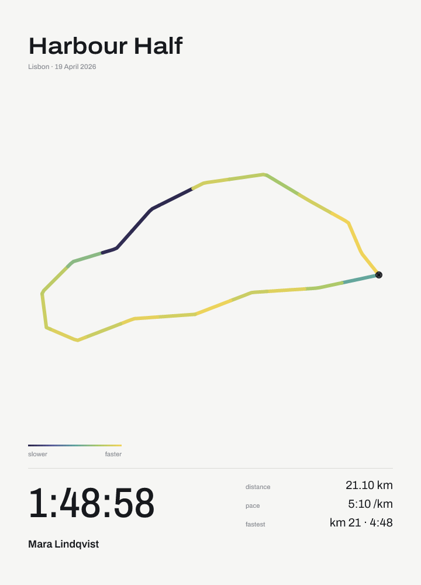
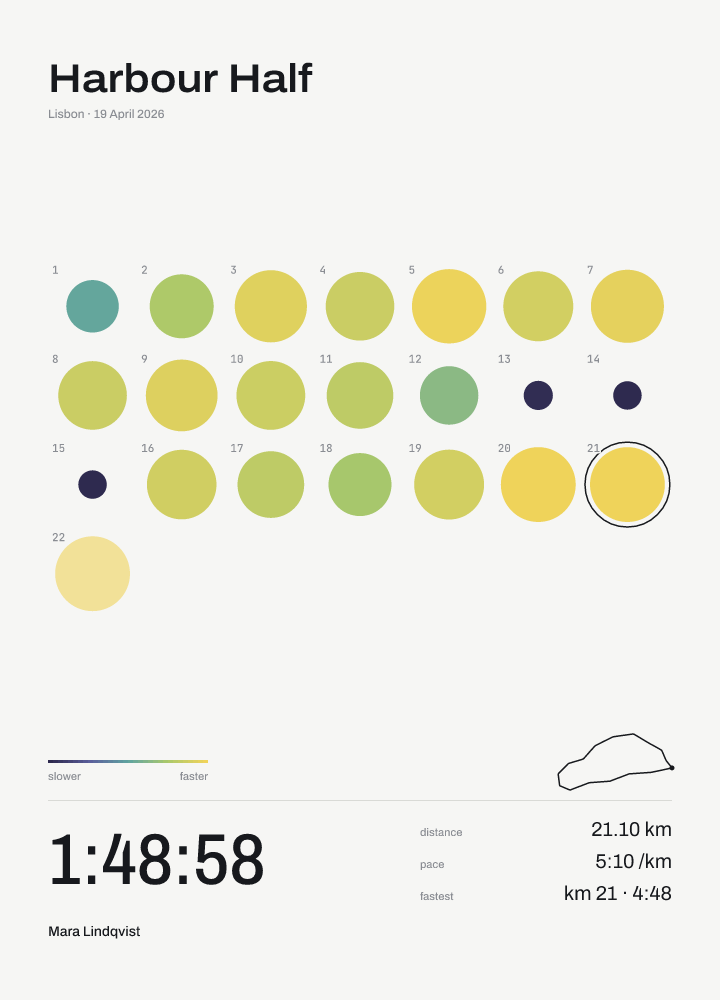
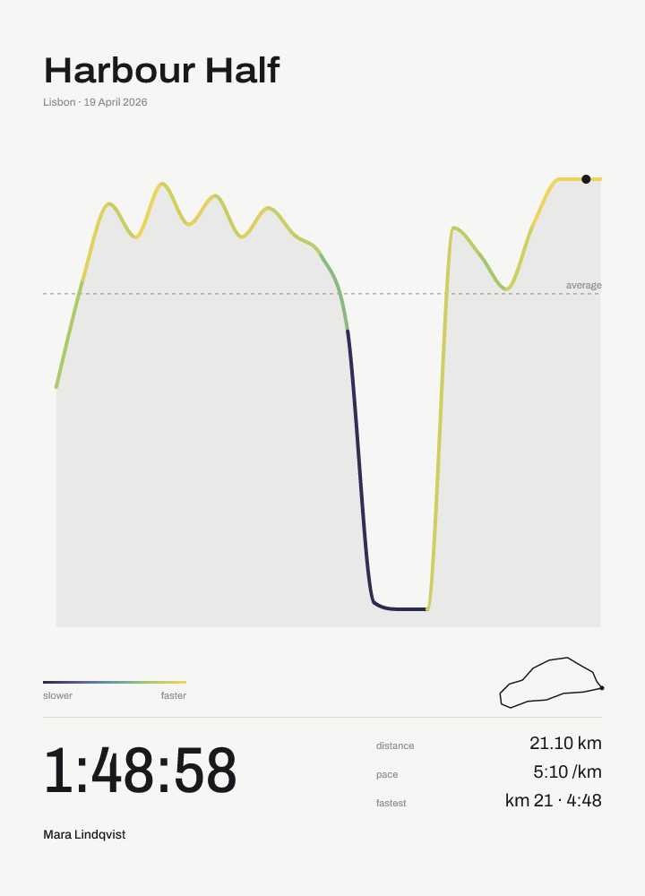
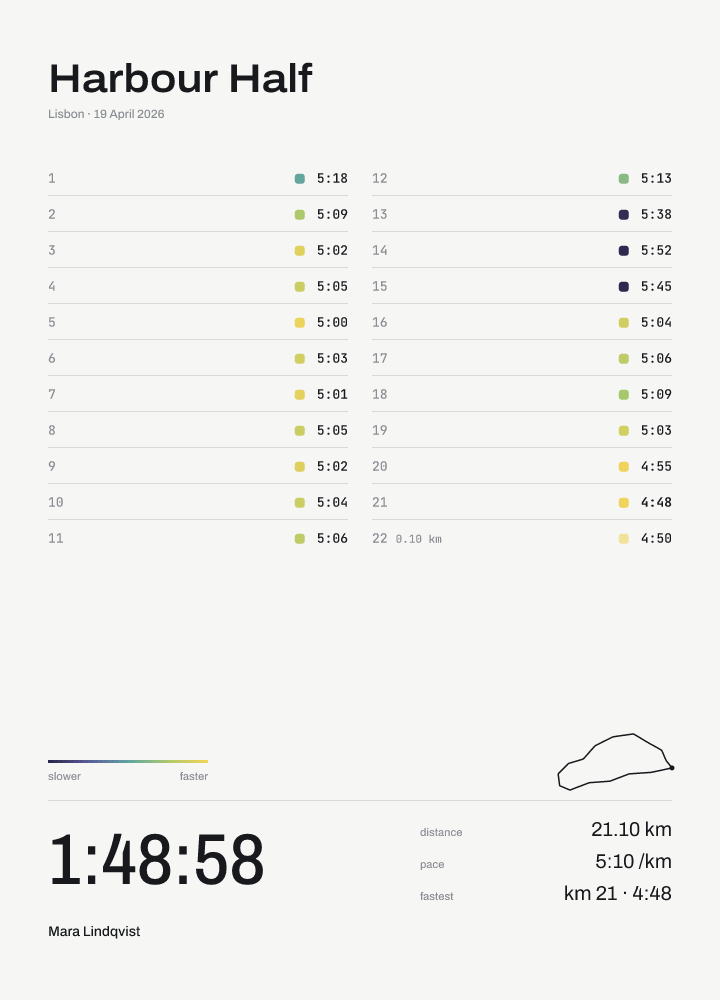
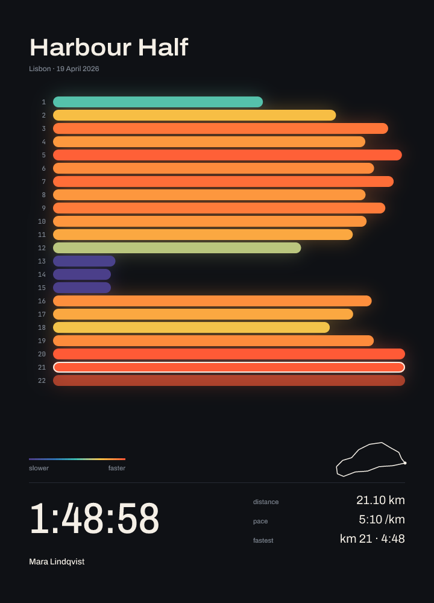

# runcard

runcard turns a GPX track into a typographic card for one run, as a PNG or
SVG. Each kilometre is coloured by its pace on a scale from deep violet for
the slowest to warm yellow (coral on dark paper) for the fastest, and drawn as
one of six pictures: bars, a spiral, the route, dots, a curve or a table.
Around it the card sets the event, the city and date, the finish time, the
distance, the average pace, the fastest kilometre and the runner's name, on
light or dark paper. The GPX file needs timestamps, since the paces are worked
out from them.



## Usage

```
runcard <INPUT.gpx> --runner <NAME> [--event <NAME>] [--city <CITY>] [--date <YYYY-MM-DD>] [-o <OUT.png>] [--scale <F>] [--variant <NAME>] [--theme <light|dark>] [--svg <OUT.svg>] [--timing]
```

| Flag | Meaning |
| --- | --- |
| `--runner <NAME>` | Runner's name, shown as typed. Required. |
| `--event <NAME>` | Event title. Default: the GPX track name, else `Run`. |
| `--city <CITY>` | City in the line under the title (`Lisbon · 19 April 2026`). |
| `--date <YYYY-MM-DD>` | Date of the run. Default: the UTC date of the first timestamp, else today. |
| `-o, --output <OUT.png>` | PNG to write. Default: the input path with a `.png` extension. |
| `--scale <F>` | Raster scale over the 720x1000 card, must be above 0. Default: `2` (1440x2000). |
| `--variant <NAME>` | Picture of the splits: `ribbon`, `spiral`, `trail`, `dots`, `wave` or `ledger` (`--help` describes each). Default: `ribbon`. |
| `--theme <light\|dark>` | Light or dark paper, independent of the variant. Default: `light`. |
| `--svg <OUT.svg>` | Also write the card as SVG. |
| `--timing` | Print the time spent in each stage to stderr. |

On success runcard prints `wrote <OUT.png>` and nothing else (the `--timing`
lines go to stderr). Errors go to stderr with exit code 1; invalid or missing
arguments exit with code 2.

```
runcard examples/sample.gpx --runner "Mara Lindqvist" --city Lisbon
```

## Variants

Six pictures of the same splits, chosen with `--variant` or the `variant`
part, each in the same frame and on either theme. All are rendered from
`examples/sample.gpx`. Every variant but `trail`, whose picture is the route,
also shows the course in miniature right of the legend, so each run stays
recognisable.

| `ribbon` | `spiral` | `trail` |
| --- | --- | --- |
|  |  |  |
| One bar per kilometre, longer and brighter the faster it was run. The default. | The kilometres wound outward from the centre as one coloured spiral. | The route itself, each kilometre drawn in the colour of its pace. |

| `dots` | `wave` | `ledger` |
| --- | --- | --- |
|  |  |  |
| A grid of dots, one per kilometre, larger for the faster ones. | The pace as a smooth curve over the distance, rising when faster. | The splits as a table of figures, a colour swatch beside each pace. |

With `--theme dark` or the `theme` part the card is set on near-black paper,
the colours brighter and the picture glowing:



## Server

`runcard-server` serves the same pipeline over HTTP; the `runcard` CLI is
unchanged.

```
runcard-server [--bind <ADDR>] [--allow-origin <ORIGIN>]... [--max-body-mib <N>]
```

| Flag | Environment | Meaning |
| --- | --- | --- |
| `--bind <ADDR>` | `RUNCARD_BIND` | Address to listen on. Default: `0.0.0.0:8080`. |
| `--allow-origin <ORIGIN>` | `RUNCARD_ALLOW_ORIGIN` | Origin a browser may call the API from, repeatable (comma separated in the environment); `*` allows any. Default: none, and no CORS headers. |
| `--max-body-mib <N>` | `RUNCARD_MAX_BODY_MIB` | Largest request body in MiB. Default: `20`. |

The server logs to stderr, starting with `listening on <ADDR>`. `RUST_LOG`
sets the log filter (default `info`; `RUST_LOG=info,tower_http=debug` adds the
requests). Ctrl-C or SIGTERM stops it once the requests in flight are answered. If it
cannot start, for example because the port is taken, it exits with code 1.

### `POST /cards`

A `multipart/form-data` form with the parts below. Other parts are ignored,
and a blank optional part counts as not given.

| Part | Meaning |
| --- | --- |
| `gpx` | The GPX file. Required. |
| `runner` | Runner's name, shown as typed. Required. |
| `event` | Event title. Default: the GPX track name, else `Run`. |
| `city` | City in the line under the title. |
| `date` | Date of the run as `YYYY-MM-DD`. Default: the UTC date of the first timestamp, else today. |
| `scale` | Raster scale over the 720x1000 card, above 0 and at most 8. Default: `2`. |
| `format` | `png` or `svg`. Default: `png`. |
| `variant` | Picture of the splits, one of the names `GET /variants` lists. Default: `ribbon`. |
| `theme` | `light` or `dark`. Default: `light`. |

The answer is the card with status 200, `Content-Type: image/png` (or
`image/svg+xml; charset=utf-8`) and
`Content-Disposition: inline; filename="card.png"` (or `card.svg`). Errors
come as JSON, `{"error":"<message>"}`:

| Status | When |
| --- | --- |
| 400 | `gpx` or `runner` is missing or empty; `date`, `scale`, `format`, `variant` or `theme` is invalid (e.g. `invalid theme: expected light or dark, got "sepia"`); the multipart body is malformed; the GPX cannot be parsed or analysed (the message says why, e.g. `track has no timestamps, pace cannot be derived`). |
| 413 | The body is larger than `--max-body-mib`. |
| 415 | The body is not `multipart/form-data`. |
| 500 | Rendering failed. The message is `rendering failed`; the details go to the log. |

```
curl -F gpx=@run.gpx -F runner="Mara Lindqvist" -F city=Lisbon -F theme=dark -o card.png http://localhost:8080/cards
```

### `GET /variants`

Answers 200 with the variants in display order, the default first, each
with one sentence on what it draws:
`[{"name":"ribbon","description":"..."},{"name":"spiral","description":"..."},...]`.

### `GET /health`

Answers 200 with `{"status":"ok"}`.

## Limits

A long event title is set smaller until it fits the 624 px line, down to
28 px, and cut with an ellipsis if it does not fit even then. A long runner's
name is cut with an ellipsis at its size. A long city is cut before the date,
so the line under the title always ends with the whole date. Every track point
needs a timestamp, and no timestamp may be earlier than the one before it.
Runs of one metre or less are rejected.

## Build

```
cargo build --release
```

The binaries are `target/release/runcard` (the CLI) and
`target/release/runcard-server` (the HTTP server). The fonts and the SVG
templates are compiled into both, so they run without any other files.
`cargo test` runs the test suite.

### Docker

```
docker build -t runcard-server .
docker run --rm -p 8080:8080 -e RUNCARD_ALLOW_ORIGIN=https://example.com runcard-server
```

The `Dockerfile` builds `runcard-server` in a `rust:1.99-bookworm` stage and
copies the binary into `gcr.io/distroless/cc-debian12:nonroot`, about 12 MB
in all, running as `nonroot` on port 8080. The cargo registry and the target
directory are BuildKit cache mounts, so rebuilding after a code change does
not recompile the dependencies. The server stops cleanly on the SIGTERM that
`docker stop` sends.

## Fonts

The card is set in Archivo (the frame: title, time, labels and values) and
JetBrains Mono (figures inside the pictures), both variable fonts under the
SIL Open Font License 1.1. Each text role sets its own point on the font's
axes, for example the title at width 112 and weight 600 and the time at width
85 and weight 500. The font files and their licence texts are in `fonts/`, and
`fonts/fetch.sh` downloads them again from the google/fonts repository.

## Timing

Rendering `examples/sample.gpx` (a half marathon, 212 points) at the default
scale with `--timing`, release build, second of two consecutive runs on an
Apple M4 Pro:

```
parse 0.6 ms
analyze 0.0 ms
layout 0.1 ms
svg 0.1 ms
png 9.8 ms
total 10.6 ms
```

`layout` includes measuring the names against the bundled fonts. `svg` is
filling the template, `png` rasterising and PNG encoding. Loading the fonts
and the templates before `parse` and writing the files after `png` are not
counted; `total` is the sum of the stages.
